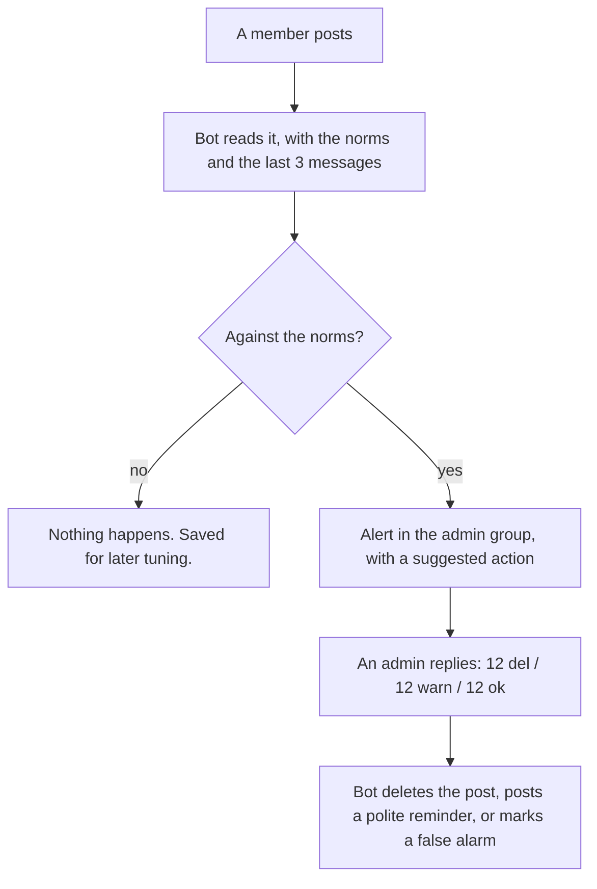

# WhatsApp moderation bot kit

Build your own moderation helper for a WhatsApp group. It reads every message, checks it against your group's norms, and asks an admin before it does anything.

This is the kit behind **Buddy**, the moderation bot in a 1,000-member AI study group. It was built in a few hours and costs about 10 US cents a day to run.

## How it works



The bot never acts without an admin, and it cannot remove members.

## What's inside

| Path | What it is |
|---|---|
| [`skills/wa-moderation-bot/SKILL.md`](skills/wa-moderation-bot/SKILL.md) | A skill for Claude Code (or another coding agent) that walks you through building and deploying your own bot |
| [`skills/wa-moderation-bot/template/`](skills/wa-moderation-bot/template/) | The working app: one Python file, deploy settings and a GitHub Actions workflow |
| [`docs/how-it-was-built.md`](docs/how-it-was-built.md) | The goal, the needs, the tools picked and why, and what we learned |

## Quick start with Claude Code

1. Copy the skill into your skills folder:
   ```bash
   cp -r skills/wa-moderation-bot ~/.claude/skills/
   ```
2. Start Claude Code in an empty folder and say: "Build me a WhatsApp moderation bot for my group."
3. Have these ready: a spare phone number with WhatsApp, a [TypeSafe](https://typesafe.ai) API key, a [Plash](https://pla.sh) account, and your group's norms in plain words.

## Quick start by hand

1. Copy `skills/wa-moderation-bot/template/` to a new folder.
2. Edit `DEFAULT_RULES` and `CATEGORIES` in `main.py` to match your group.
3. Copy `plash.env.example` to `plash.env` and fill in your key and an admin password.
4. Set your app name in `.plash`, then run `plash-deploy`.
5. Open `https://<your-app>.pla.sh/admin`, scan the QR code with the bot's WhatsApp, and copy the group IDs from that page into `plash.env`.
6. Deploy again and post a test message.

The skill file has the full steps and the things that tend to go wrong.

## Before you go live

- Keep the admin group invite only. Anyone in it can send "12 del" or "12 warn", because the code checks which group a message came from, not who sent it.
- Use a long, random admin password. The `/admin` page shows the WhatsApp login QR code, so whoever has the password could link their own device to the bot.
- Tell your members that a bot reads the group. Messages and scores are stored in `data/admin.db` on the server, so decide how long you want to keep them.
- Make the bot's number an admin of the watched group. If it is not, deletes will fail.
- Keep `plash.env` and `data/` out of git. They are already in `.gitignore`.

## Built with

- [neonize](https://github.com/krypton-byte/neonize) to use WhatsApp from Python
- [Jev by TypeSafe](https://typesafe.ai) to judge each message
- [FastHTML](https://fastht.ml) for the admin page
- [Plash](https://pla.sh) for hosting

neonize is not an official WhatsApp API. Use a spare number, and follow WhatsApp's terms.

## License

MIT
